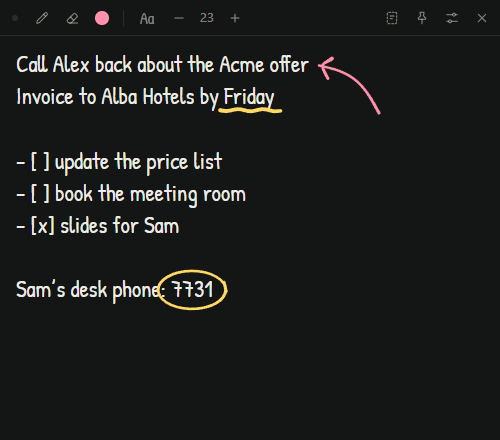

# Appunto

[](https://github.com/ldgweb/appunto/actions/workflows/ci.yml)
[](LICENSE.md)

A small blackboard that is always one shortcut away. Press `Ctrl+Alt+Space` (`⇧⌘Space` on a Mac) in any app, write a note, press it again and you're back to work. It saves as you type.

*Appunto* is Italian for a quick note.



- You can write on it by hand. `Ctrl+D` turns the mouse, a pen or a finger into chalk, so you can circle a number or draw an arrow right over your notes.
- It has a scratch pad that is never saved. `Ctrl+T` opens a second page where you can paste text to drop its formatting, or keep it for a minute before pasting it somewhere else. It empties when you quit.
- There are no files to name and no account. Your notes stay on your computer.

## Why I made it

People ask me for things while I'm at the computer, and ideas tend to show up at the worst moment. I used to grab a sheet of paper. A text editor wants a file name, a notes app wants an account. I wanted something as quick as paper: one key, write, hide.

## Install

Download it from [Releases](https://github.com/ldgweb/appunto/releases):

- Windows: `appunto_<version>_x64-setup.exe`, no admin rights needed. There's also a portable ZIP.
- macOS: `appunto_<version>_universal.dmg`
- Linux: `.AppImage`, `.deb` or `.rpm`

The installers aren't signed yet. Windows may say "Windows protected your PC": click More info, then Run anyway. On a Mac, move the app to Applications and run `xattr -dr com.apple.quarantine /Applications/Appunto.app`, or allow it in System Settings > Privacy & Security. Every file can be checked against `SHA256SUMS.txt` in the release.

I use and test Appunto on Windows. The macOS and Linux builds come from CI and nobody has tried them on a real machine yet, so consider them experimental. If you do try them, I'd like to hear how it went.

There are no automatic updates. New versions are downloaded by hand, and your notes stay where they are.

## How it works

It starts with the system and waits in the background. The shortcut shows the board ready for typing, and hides it again.

| Keys | |
| --- | --- |
| `Ctrl+Alt+Space` | Show or hide, from any app. You can change it in Settings |
| `Esc` | Hide |
| `Ctrl+D` | Draw. Press it again to go back to writing |
| `Ctrl+E` | Eraser. The right mouse button erases too |
| `Ctrl+T` | Scratch pad |
| `Ctrl` `+`, `Ctrl` `-`, `Ctrl+0` | Text size |
| `F5` | Date and time |

On a Mac, use `⌘` instead of `Ctrl`.

Lines that start with `-`, `*`, `1.` or `- [ ]` continue when you press Enter. Strokes scroll with the text. Settings has the font, the background, launch at login, and New board, which clears the board and keeps a copy in the archive.

The installer is under 2 MB and the app uses about 5 MB of memory, plus the system's web view (WebView2 on Windows).

## Your notes

Everything stays on your computer, in plain JSON files:

- Windows: `%APPDATA%\io.github.ldgweb.appunto`
- macOS: `~/Library/Application Support/io.github.ldgweb.appunto`
- Linux: `~/.local/share/io.github.ldgweb.appunto`

Settings > Open data folder takes you there. Every save goes through a temporary file, so a crash can't leave half a board. A damaged file is set aside, never deleted.

Appunto doesn't go online. There's no account, no telemetry and no update check. The notes aren't encrypted, though, so don't keep passwords on the board. [SECURITY.md](SECURITY.md) has the details.

## A few things to know

- Linux with Wayland doesn't let apps listen to keys globally. Add a system shortcut that runs `appunto --toggle` instead.
- On Linux the tray icon needs `libayatana-appindicator3-1`, and on GNOME the AppIndicator extension.
- `appunto --hidden` starts it without showing the board.
- To uninstall on Windows, use Settings > Apps. On macOS and Linux, turn off Start with the system first, then delete the app.

## Building it

You need Node.js 22.18 or newer, Rust through rustup and the [Tauri prerequisites](https://v2.tauri.app/start/prerequisites/) for your system.

```bash
npm ci
npm run tauri:dev     # run it with hot reload
npm run tauri:build   # build the installer
```

The checks and a map of the code are in [CONTRIBUTING.md](CONTRIBUTING.md).

I work on Appunto in my spare time. Issues and pull requests are welcome, but replies may take a while. Please don't paste your own notes into an issue: a few made-up lines are enough.

## License

[MIT](LICENSE.md) © 2026 Lucio (ldgweb). The bundled fonts and libraries are listed in [THIRD-PARTY-NOTICES.md](THIRD-PARTY-NOTICES.md).
